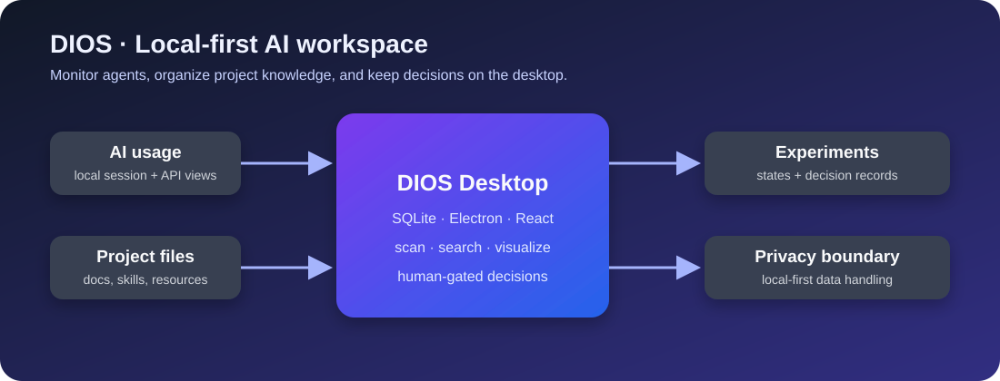

# DIOS - Document Intelligence & Organization System

> 로컬 중심의 AI 에이전트 모니터링 및 문서 관리 시스템



DIOS는 데스크톱에서 AI 서비스 사용량, 프로젝트 문서, Skills, 실험과 Human Gate를 한곳에서 관리하는 로컬 우선 작업공간입니다.


## 🎯 개요

DIOS는 **로컬 우선(Local-First)** 철학을 기반으로 하는 AI 에이전트 모니터링 및 문서 관리 시스템입니다. 여러 AI 서비스의 사용량을 실시간으로 추적하고, 프로젝트 문서와 스킬을 체계적으로 관리합니다.

## ✨ 주요 기능

### 🤖 Agent Monitor (에이전트 모니터)

구독형 및 API 기반 AI 서비스의 사용량을 실시간으로 추적합니다.

**지원 서비스:**

| 서비스 | 방식 | 추적 방법 |
|--------|------|-----------|
| **OpenAI** | API 키 | ✅ 실시간 API 조회 |
| **Codex** | ChatGPT Plus/Pro 구독 | ⚠️ 로컬 세션 로그 파싱 |
| **Claude Code** | Claude Pro/Max 구독 | ⚠️ 로컬 세션 로그 파싱 |
| **OpenRouter** | API 키 | ✅ 실시간 API 조회 |
| **CommandCode** | API 키 | ✅ 실시간 API 조회 |
| **OpenCode** | 구독 | ⚠️ 콘솔 수동 추적 |
| **Qwen Studio** | API 키 | ✅ 실시간 API 조회 |
| **Goose** | OpenRouter 연동 | ✅ 실시간 API 조회 |

**에이전트 펫 위젯:**
- 사용량에 따라 반응하는 귀여운 캐릭터
- 🎉 여유 → 🚴 순조로움 → 💦 빡빡 → 😱 위험 → 💀 초과
- 실시간 상태 메시지로 현재 상황 파악

**사용량 대시보드:**
- 서비스별 게이지 바 (일/주/월 사용량)
- 리셋까지 남은 일수
- 마지막 갱신 시각
- Skills 및 Markdown 파일 카운터

### 📁 프로젝트 관리

- 프로젝트별 문서 및 리소스 관리
- 폴더 연결 (Skills, Memory, 프로젝트 자료)
- 프로젝트 내보내기/가져오기 (JSON 형식)
- 프로젝트 운영지침(Runbook) 관리

### 🔍 문서 스캔 및 검색

- 로컬 폴더 스캔을 통한 문서 자동 감지
- Markdown, JSON, YAML 등 다양한 형식 지원
- 전문 검색(Full-Text Search) 기능
- 메타데이터 기반 필터링

### 🌳 파일 탐색기

- 트리 구조로 프로젝트 파일 탐색
- 실시간 파일 내용 미리보기
- 빠른 파일 검색 및 필터링

### 🧠 Skills & Memory 관리

- 재사용 가능한 스킬 관리
- 영구 메모리 저장소
- 스킬 간 관계도 시각화

### 📊 실험 및 의사결정

- 실험 상태 머신 (DRAFT → APPROVED → RUNNING → COMPLETED)
- 의사결정 기록 (블록체인 스타일 체인)
- Human Gate (승인 게이트) 시스템

### 🛡️ 비상 정지 (Emergency Stop)

- 모든 AI 에이전트 작업 즉시 중단
- 글로벌 비상 정지 버튼
- 안전 모드 전환

## 🚀 설치 및 실행

### 사전 요구사항

- Node.js 18+
- npm 또는 yarn

### 설치

```bash
# 저장소 클론
git clone https://github.com/ju0o/Dios.git
cd Dios

# 의존성 설치
npm install
```

### 개발 모드

```bash
npm run dev
```

### 프로덕션 빌드

```bash
npm run build
```

빌드된 앱은 `release/` 폴더에서 확인할 수 있습니다.

## 📁 프로젝트 구조

```
DIOS/
├── electron/              # Electron 메인 프로세스
│   ├── main.ts           # 메인 프로세스 진입점
│   ├── preload.ts        # 프리로드 스크립트
│   └── db/
│       └── schema.ts     # SQLite 스키마
├── src/
│   ├── core/             # 핵심 비즈니스 로직
│   │   ├── agent-monitor/    # 에이전트 모니터링
│   │   ├── ai-resource/      # AI 리소스 관리
│   │   ├── scanner/          # 파일 스캐너
│   │   ├── graph/            # 그래프 빌더
│   │   ├── experiment/       # 실험 관리
│   │   ├── decision/         # 의사결정 기록
│   │   └── human-gate/       # Human Gate
│   └── renderer/         # React 렌더러
│       ├── pages/        # 페이지 컴포넌트
│       ├── components/   # 공통 컴포넌트
│       └── stores/       # 상태 관리
└── package.json
```

## 🎨 디자인 철학

- **Cinematic Dark**: 시네마틱 다크 테마
- **Glassmorphism**: 글래스모피즘 UI
- **Apple Minimal**: 애플 스타일의 미니멀 디자인
- **Local-First**: 모든 데이터는 로컬에 저장
- **Privacy-First**: API 키는 암호화되어 로컬에만 저장

## 🔐 보안

- API 키는 SQLite DB에 암호화되어 저장
- 모든 데이터는 로컬에서만 처리
- 외부 서버 통신 최소화
- Context Isolation 활성화

## 🛠️ 기술 스택

- **Electron** - 크로스 플랫폼 데스크톱 앱
- **React 18** - UI 프레임워크
- **TypeScript** - 타입 안전성
- **Tailwind CSS** - 스타일링
- **SQLite (better-sqlite3)** - 로컬 데이터베이스
- **Vite** - 빌드 도구
- **Cytoscape** - 그래프 시각화

## 📝 라이선스

MIT License

## 🤝 기여

이슈 및 PR 환영합니다!

## 📞 문의

- GitHub Issues: https://github.com/ju0o/Dios/issues
- Email: ju0@example.com

---

**Made with ❤️ by ju0o**
