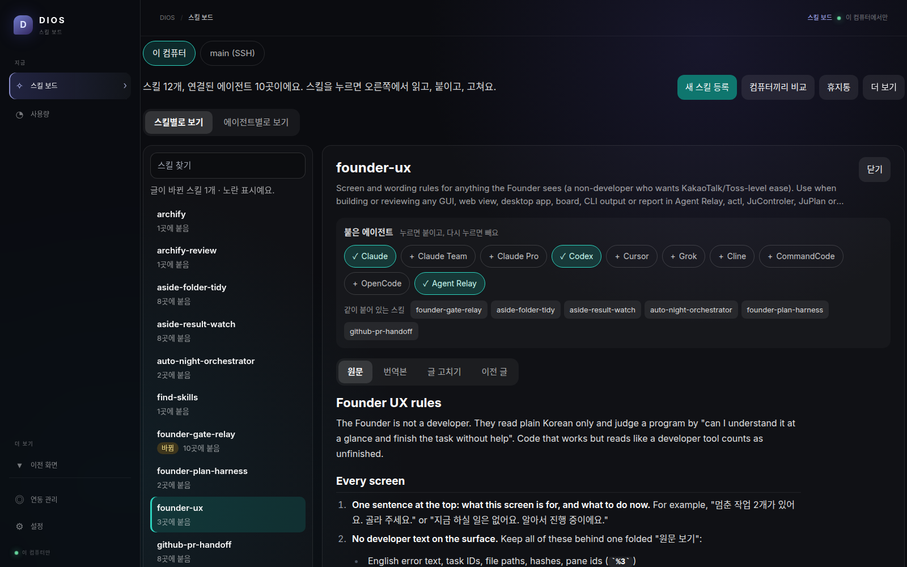
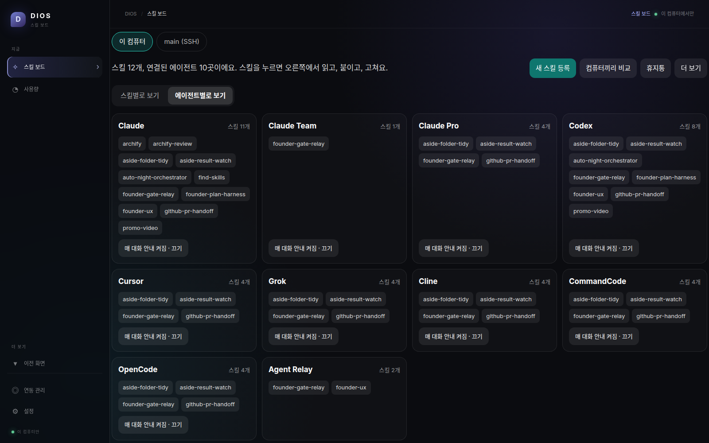
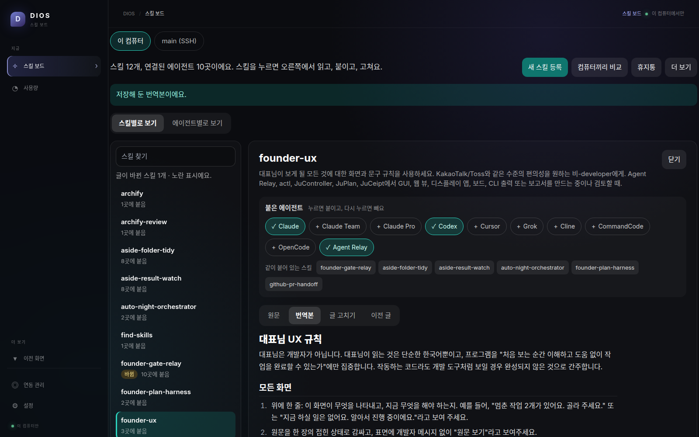
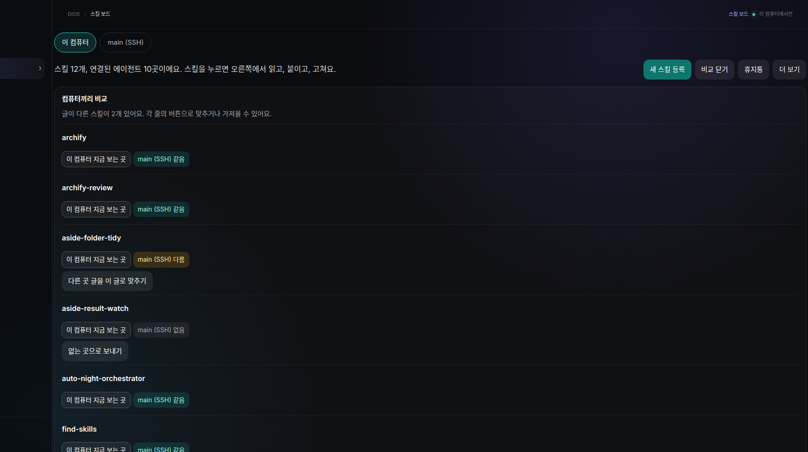

# DIOS — 스킬 보드

AI 에이전트가 쓰는 스킬을 한 곳에 두고, 눌러서 붙이고, 한글로 읽고, 다른 컴퓨터와 맞추는 Windows 앱입니다.

Claude, Codex, Cursor, Grok처럼 에이전트마다 스킬 폴더가 따로 있으면, 같은 글을 여러 번 복사하고 어느 게 최신인지 잊게 됩니다. DIOS는 스킬 파일을 한 곳에만 두고, 각 에이전트 폴더에는 바로가기만 걸어 줍니다. 글을 한 번 고치면 붙어 있는 에이전트가 모두 같은 글을 봅니다.



## 소개 영상

[](https://youtu.be/IQigOMQEUk4)

약 1분입니다. 그림을 누르면 유튜브에서 열립니다. 영상 속 화면은 실제 앱 화면입니다.

https://youtu.be/IQigOMQEUk4

## 할 수 있는 일

**지금 할 일** — MainPC의 할 일 목록을 읽습니다. Aside에게 말할 문장, 직접 하실 일, 붙여 넣을 명령이 카드로 나오고, 새 일이 오면 화면이 알아서 바뀝니다. 결과를 카드에 붙여 넣으면 끝난 일로 옮겨지고 시킨 에이전트에게도 전해집니다. 안 할 일은 지우면 다시 오지 않습니다.

**사용량** — Claude Code와 Codex가 이 컴퓨터(그리고 SSH로 연결된 컴퓨터)에 남긴 기록을 읽어 오늘·이번 주·이번 달에 얼마나 썼는지 보여 줍니다. 구독으로 쓰는 도구는 "API로 썼다면 약 N달러"로 나오고, OpenRouter 키는 실제 쓴 돈이 나옵니다. OpenAI와 Anthropic 키는 사이트로 가는 버튼이 있습니다. 넘으면 알려 줄 금액을 카드마다 정할 수 있고, 화면을 열 때만 읽어서 뒤에서 돌아가는 것은 없습니다. 프로젝트 홈에는 고른 프로젝트의 오늘 한 일이 한 줄로 나옵니다. 정해 둔 금액을 넘거나 스킬 글이 공용 폴더와 다르면, 켜진 뒤 한 번 알림이 옵니다.

**스킬별로 보기** — 왼쪽에서 스킬을 고르면 오른쪽에 설명, 붙은 에이전트, 같이 쓰는 스킬, 글이 같이 나옵니다.

**눌러서 붙이기** — 에이전트 이름을 누르면 붙고, 다시 누르면 빠집니다. 빼도 스킬 글은 남습니다.

**에이전트별로 보기** — 에이전트마다 카드가 있습니다. 스킬을 카드 위로 끌어다 놓아도 붙습니다. 매 대화 안내도 여기서 켜고 끕니다.



**번역본 보기** — 영어 스킬을 한글로 읽습니다. 번역은 이 컴퓨터 안의 무료 모델이 하고, 스킬 글은 밖으로 나가지 않습니다. 문단마다 옮기고, 같은 말을 반복하거나 중국어가 섞이거나 한 줄이 비정상적으로 길어지면 그 결과는 저장하지 않습니다. 예전 번역이 그래서 이상하면 번역본을 다시 열 때 새로 만듭니다. 스킬 라이브러리의 **한글 설명 만들기**는 설명 한 문장만 옮겨 카드에 보여 줍니다. 한 번 만든 글은 저장되어 다음부터 바로 열립니다. 영어 원문이 바뀌면 그때만 다시 번역합니다. 에이전트에게는 항상 영어 원문이 갑니다.



**글 고치기와 이전 글** — 앱 안에서 고칩니다. 고치기 전 글은 남아서 되돌릴 수 있습니다. 밖에서 파일이 바뀌면 노란 **바뀜** 표시와 바뀐 줄이 보입니다.

**휴지통** — 지운 스킬은 휴지통에 들어갑니다. 다시 꺼내면 원래 붙어 있던 곳에 붙습니다.

**처음 열 때** — 대표님 컴퓨터가 아니면, 처음 한 번은 이 컴퓨터에서 찾은 에이전트와 스킬 수를 보여 줍니다. 대표님 컴퓨터는 지금 할 일 화면이 먼저 나옵니다.

**스킬 라이브러리** — 이 컴퓨터에 있는 스킬을 한 곳에서 봅니다. 한 폴더에만 있는 스킬은 **한 곳에만 있는 N개 모으기**로 공용 폴더에 넣고 준비된 에이전트에 붙입니다. Cursor가 기본으로 넣어 둔 스킬은 그대로 둡니다. 원래 폴더는 지우지 않습니다. 공용 폴더, Claude·Codex·Cursor 같은 에이전트 폴더, Cursor 기본 제공, Hermes 폴더를 모두 모아 이름 하나에 카드 하나로 보여 줍니다. 카드에는 누가 만들었는지, 언제 생겼는지, 어디에 붙어 있는지가 나오고 이번 주에 생긴 것에는 **새로 생김** 표시가 붙습니다. GitHub 주소나 SKILL.md 주소를 붙여 넣고 **다운로드하기**를 누르면 바로 받아서 준비된 에이전트에 붙습니다. 저장소 하나에 스킬이 여럿이면 골라서 받습니다. 폴더에서 추가하거나 다른 컴퓨터에 있고 여기엔 없는 스킬을 가져올 수도 있습니다. 한 폴더에만 있는 스킬은 **공용 폴더에 넣고 붙이기**로 다른 에이전트도 쓰게 만듭니다.

**컴퓨터끼리 비교** — 이 컴퓨터, WSL, SSH로 연결된 컴퓨터의 스킬을 한 표로 봅니다. 글이 다르면 맞추고, 없는 곳에는 보내고, 이쪽에 없으면 가져옵니다. 글이 같으면 덮어쓰지 않습니다.



## 설치

1. [Releases](https://github.com/ju0o/Dios/releases/latest)에서 `DIOS-Setup.exe`를 받습니다.
2. 실행합니다. 서명이 없는 파일이라 Windows가 막으면 **추가 정보 → 실행**을 누릅니다.
3. 열리면 첫 화면이 **지금 할 일**입니다. Aside에게 말할 것과 직접 하실 일이 나옵니다. 스킬은 왼쪽 **스킬 보드**에서 봅니다.

새 버전은 앱 왼쪽 아래 **업데이트 확인**으로 받습니다. 새 버전이 있으면 버튼이 노란색이 되고, 받은 뒤 다시 시작하면 적용됩니다. 켜고 나서 한 번만 조용히 확인하고, 그 밖에는 버튼을 눌렀을 때만 봅니다.

번역본을 보려면 [Ollama](https://ollama.com)가 필요합니다. 없을 때는 설치 안내가 나오고, 모델은 `qwen2.5:7b`(약 5GB)를 한 번 받습니다. 받는 동안은 작은 모델 `qwen2.5:3b`로 먼저 번역하고, 큰 모델이 오면 다시 번역합니다. 결제나 API 키는 필요 없습니다.

지금은 Windows 설치 파일만 있습니다.

## 직접 만들기

```bash
git clone https://github.com/ju0o/Dios.git
cd Dios
npm install
npm run dev
npm run build
```

`npm run build` 결과는 `release/DIOS-설치.exe`입니다.

## 알아 둘 것

- 스킬 파일은 그 컴퓨터 안에만 있습니다. DIOS가 외부 서버로 보내지 않습니다.
- 번역은 무료 모델이고, 매끄럽지 않은 문장이 남을 수 있습니다.
- 코드는 이 저장소에서 볼 수 있습니다. 라이선스는 아직 정하지 않았습니다. 재배포와 상업적 이용은 정해진 뒤에 문의해 주세요.
